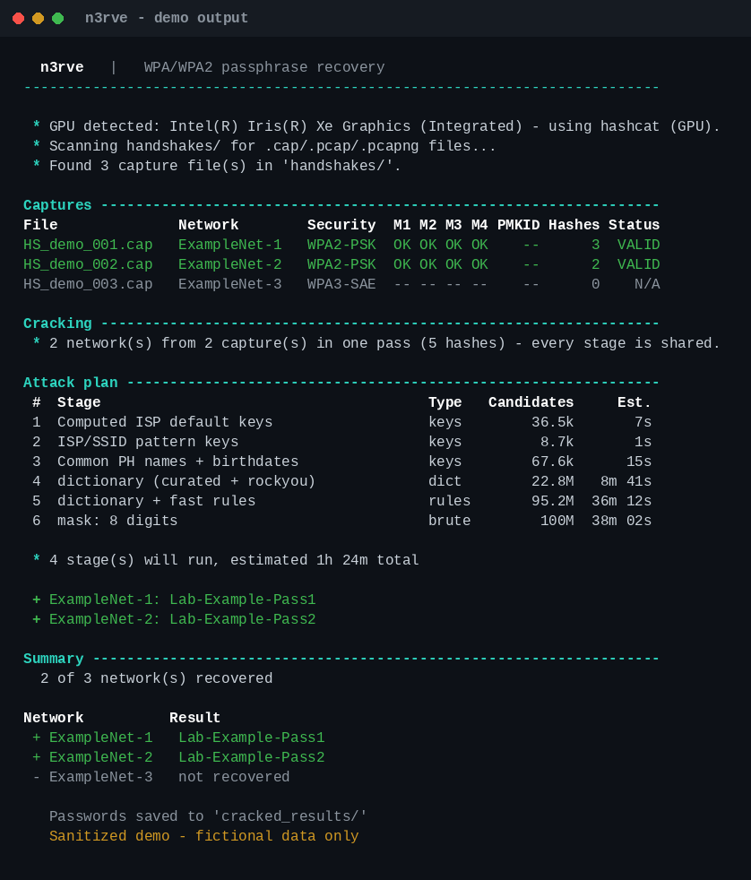

# n3rve

> **n3rve** - Automated WPA/WPA2 passphrase recovery from captured 802.11 handshakes and PMKIDs. GPU-accelerated via hashcat with CPU fallback, Philippine ISP default-key intelligence, and engagement-ready reporting.

> ### Credits & Attribution
> **n3rve** is built on **[handshakeCracker](https://github.com/Mysteriza/handshakeCracker)** by **[Mysteriza](https://github.com/Mysteriza)**. The original design, architecture, and engineering are their work; this project builds on that foundation with substantial rewrites, a Philippines-focused ISP default-key stage, and related tuning. If you find this useful, please **star and support the [original project](https://github.com/Mysteriza/handshakeCracker)**.
>
> See **[CHANGELOG.md](CHANGELOG.md)** for a transparent list of what was added, changed, and fixed relative to upstream.

[](https://python.org)
[](https://github.com/astral-sh/ruff)
[](https://pytest.org)
[](LICENSE)
[](Containerfile)

---

## ⚠️ Authorized Use Only

**n3rve is intended for authorized security assessments, penetration testing engagements, and educational lab environments only.** Unauthorized access to wireless networks is illegal. The author assumes no liability for misuse. Only run this against networks you own or have explicit written permission to test.

---

## Features

| Capability | Description |
|------------|-------------|
| **GPU-accelerated cracking** | hashcat (OpenCL/CUDA) as primary cracker, aircrack-ng (CPU) as fallback |
| **PMKID (clientless) attacks** | Extract RSN PMKID from M1 frames - no connected client required |
| **Multi-network captures** | One hash per AP in a single capture; all cracked in one shared pass |
| **Replay-counter-accurate pairing** | EAPOL frames matched by key replay counter - no spliced, uncrackable hashes |
| **Dual extractors** | Built-in scapy parser + hcxpcapngtool, results merged |
| **ESSID recovery** | From beacons, probe responses, association requests, and filename fallback |
| **Formats** | `.cap`, `.pcap`, `.pcapng` |
| **PH ISP default keys** | Computed factory keys for PLDT, Converge, Globe, Smart, DITO, Sky, and more |
| **International derivable keys** | RouterKeygen ports: Arcadyan, Zyxel, Huawei HG824x, Sky V1, Wlan6, Bssid family |
| **Speed-gated attack plan** | Stages auto-skipped when estimated runtime exceeds budget |
| **Engagement reports** | Self-contained Markdown reports with findings, risk ratings, remediation |
| **Duplicate skip** | Skips networks already cracked in prior runs (matched by SSID) |
| **PH-specific mask patterns** | PH mobile numbers (0917-0921), birthdates (MMDDYYYY/DDMMYYYY), landline formats - added to every ISP family |
| **Expanded hashcat rules** | 60+ rules with PH mobile prefixes, years (2020-2025), leet speak, Filipino terms, special-char suffixes |
| **Wordlist priority sorting** | PH-first ordering: ISP names, mobile prefixes, years, short numerics, and Filipino terms tried before long random strings |
| **Handshake extraction** | Accepts partial handshakes (M2 + M1 *or* M3) and M4 pairs with a usable SNONCE |
| **Curated wordlist** | ~8.5M real-world passwords, filtered to 8-63 chars and sorted |
| **Custom wordlist** | Use the bundled list or your own `.txt`; also a `wordlists/` drop-in folder |
| **Security-mode detection** | Labels WPA2-PSK / WPA3-SAE / WPA2-Enterprise / OWE / WEP / Open and explains dead ends |
| **Smart fallback** | If hashcat exhausts the keyspace, skips a pointless aircrack-ng pass |
| **One-time kernel warmup** | First run compiles GPU kernels once, cached for later runs |
| **OpenCL preflight** | Detects a missing compute device and prints the exact package to install |
| **Zero-config** | Auto-installs Python deps and cracking tools on first run where supported |
| **Cross-platform** | Windows + Linux auto-setup (apt/dnf/pacman/zypper) and a container path |
| **Per-network validation table** | One row per AP with M1-M4/PMKID and the reason any network was rejected |
| **Dynamic GPU workload** | Workload 4 + optimized kernels on discrete GPUs, safe defaults on integrated |
| **Debug logging** | Rotated logs in `logs/` |
| **Permission resilient** | Falls back to the temp dir when the project directory isn't writable |

---

## Demo



*Illustrative output with fictional example data (no real networks, SSIDs, or passwords).*

---

## Project Structure

```
n3rve/
├── Containerfile              # Podman / Docker build definition
├── main.py                    # CLI entry point
├── pyproject.toml             # Project metadata & dependencies
├── requirements.txt           # Runtime Python dependencies
├── requirements-dev.txt       # Dev / lint / test dependencies
├── LICENSE                    # MIT license
├── README.md                  # This file
├── CONTRIBUTING.md            # Contribution guidelines
├── SECURITY.md                # Security policy
├── .env.example               # Environment variable template
├── .github/
│   └── workflows/
│       └── ci.yml             # CI pipeline (lint + test)
├── bin/                       # Auto-populated cracker binaries (gitignored)
├── cracked_results/           # Recovered passwords (gitignored)
├── handshakes/                # Place .cap/.pcap/.pcapng files here
├── hc22000_cache/             # hashcat potfile + temp hashes (gitignored)
├── logs/                      # Rotated debug logs (gitignored)
├── rules/                     # hashcat wordlist mutation rules
├── src/
│   ├── __init__.py
│   ├── config.py              # Paths, URLs, constants
│   ├── console.py             # Rich terminal output + logging
│   ├── bootstrap.py           # First-run pip install
│   ├── cracker.py             # Aircrack-ng CPU backend
│   ├── gpu.py                 # Discrete GPU detection
│   ├── handshake.py           # Frame grouping, PMKID, ESSID recovery
│   ├── hashcat/
│   │   ├── __init__.py
│   │   ├── crack.py           # hashcat GPU backend + attack plan
│   │   ├── convert.py         # Capture → hc22000 conversion
│   │   └── setup.py           # hashcat install + GPU detection
│   ├── keygen.py              # ISP default-key generation (PH + international)
│   ├── report.py              # Engagement Markdown report generator
│   ├── setup.py               # Auto-setup (aircrack-ng, hashcat, hcxtools)
│   ├── utils.py               # Downloads, locking, wordlist utils
│   └── validator.py           # Per-network validation report
├── tests/                     # 200+ unit tests
└── wifi-wordlist.txt          # Default wordlist (gitignored, ~93 MB)
```

---

## Installation

### Local (Linux / macOS / Windows)

```bash
git clone https://github.com/yourusername/n3rve.git
cd n3rve

# Create virtual environment
python3 -m venv .venv
source .venv/bin/activate   # Windows: .venv\Scripts\activate

# Install dependencies
pip install -r requirements.txt

# Run
python3 main.py
```

The tool auto-installs `aircrack-ng`, `hashcat`, and `hcxtools` on first run where supported.

### Podman / Docker (GPU passthrough)

```bash
# Build
podman build -t localhost/n3rve:latest -f Containerfile .

# Run with Intel iGPU passthrough
podman run -it --rm \
  --device /dev/dri \
  --group-add keep-groups \
  --security-opt label=disable \
  -v "$PWD:/work:z" -w /work \
  localhost/n3rve:latest python3 main.py
```

---

## Usage

```bash
# Interactive run (handshakes/ + default wordlist)
python3 main.py

# Non-interactive with default wordlist
python3 main.py --default-wordlist

# Custom capture directory
python3 main.py -H ./client-a -w wordlist.txt

# Per-stage time budget (minutes)
python3 main.py -b 240

# Deep pass: attack each unsolved network individually
python3 main.py --deep -b 240

# Write engagement report
python3 main.py -r report.md

# Validate captures only (no cracking)
python3 main.py --list

# Check status of a run in progress
python3 main.py --status
```

### Flags

| Flag | Effect |
|------|--------|
| `-H, --handshakes DIR` | Capture directory (default `handshakes/`) |
| `-w, --wordlist FILE` | Wordlist path |
| `-b, --budget MIN` | Per-stage time budget in minutes (default 120) |
| `-d, --deep` | Attack each unsolved network individually |
| `-r, --report FILE` | Write Markdown engagement report |
| `--list` | Validate and print table, exit without cracking |
| `--status` | Report status of a run in progress |
| `--no-install` | Skip automatic tool installation |
| `-W, --default-wordlist` | Use bundled default wordlist without prompt |
| `-q, --quiet` | Suppress startup banner |
| `--version` | Show version |

---

## Sample Engagement Report

Run with `-r report.md` to produce a client-ready Markdown report (illustrative
output below - fictional example data only):

```markdown
# Wireless Assessment - WPA/WPA2 Passphrase Recovery

**Date:** 2026-11-17 14:30
**Platform:** Linux 6.8
**Compute:** Intel(R) Iris(R) Xe Graphics
**Wordlist:** wifi-wordlist.txt
**Duration:** 1h 11m

## Summary

2 of 3 in-scope network(s) had their passphrase recovered (sample data).

| Network | BSSID | Security | Result | Risk |
|---------|-------|----------|--------|------|
| ExampleNet-1 | aa:bb:cc:... | WPA2-PSK | `Lab-Example-Pass1` | HIGH |
| ExampleNet-2 | de:ad:be:... | WPA2-PSK | `Lab-Example-Pass2` | HIGH |
| ExampleNet-3 | 00:11:22:... | WPA2-PSK | not recovered | LOW |

## Effort Expended

A negative result is only meaningful alongside what was searched:

- Computed ISP default keys - searched
- ISP/SSID pattern keys - searched
- PH default passwords - searched
- dictionary - searched (8.5M words)
- hybrid: wifi-wordlist-ph.txt + 4 digits - skipped (~21h exceeds budget)
- dictionary + rules - skipped (~15h exceeds budget)
```

See `cracked_results/` for individual recovered password files.

---

## Philippine ISP Coverage

n3rve includes computed default-key derivation for PH ISPs:

- **PLDT** Home Fibr / DSL / HomeBro (`wlan`, `PLDTWIFI`, `HomeBro_` forms)
- **Converge** ICT (`wlan` + nibble-complement MAC)
- **Globe** At Home PROLiNK (`3hex + WIFI + 3hex`)
- **Smart** / **MyBro** Wimax (`myBROWIFI` + MAC-decrement)
- **Sagemcom** PLDT (`PLDTWIFI` + MAC offset)
- Plus static label-printed defaults and human-pattern guesses for any ISP

---

## Improving crack rate

Cracking is coverage × speed. On a slow GPU (e.g. an integrated Iris Xe at
~40 kH/s) the honest levers are:

1. **Add bigger wordlists.** Drop any `.txt` into `wordlists/` and it is used
   automatically (deduplicated, WPA-valid only). `rockyou.txt` is the biggest
   single win - on Kali:
   ```bash
   sudo apt install wordlists
   cp /usr/share/wordlists/rockyou.txt ./wordlists/
   ```
2. **Give rules more budget.** Three rule tiers run in order - fast (~11 rules),
   medium (~41), full (~161). Each is skipped if it exceeds the per-stage
   budget, so raise it: `-b 600`. The full tier is ~9h for one network on an
   iGPU; medium is ~2.5h.
3. **Attack one network at a time for the heavy stages.** `--deep` re-runs the
   plan per unsolved network; cost scales with the number of distinct SSIDs
   (each is its own PBKDF2 salt). A single network is ~11× faster per stage than
   an 11-network batch.
4. **Focus a specific capture.** `--focus handshakes/HS_xxxx.pcap` runs the
   whole plan against one network with a live dashboard.
5. **Opt into the huge rule sets** only if you have days: `HANDSHAKE_FULL_RULES=1`.

> A network that survives all of the above is not "secure" - it means the
> passphrase was outside the searched space. The `-r report.md` effort section
> documents exactly what was tried.

---

## Development

```bash
# Install dev dependencies
pip install -r requirements-dev.txt

# Run linting
ruff check .

# Run tests
pytest tests/

# Run lint + test
ruff check . && pytest tests/
```

---

## Roadmap

- [x] GPU hashcat backend with speed-gated staging
- [x] PH ISP default-key derivations
- [x] PMKID clientless attacks
- [x] Engagement Markdown reports
- [x] Podman container with GPU passthrough
- [ ] Web dashboard for live run monitoring
- [ ] API mode for remote triggering
- [ ] Additional ISP keygen families (Asia Pacific, LATAM)
- [ ] Hashcat rule pack for PH patterns

---

## Citation

If you use n3rve in research or engagements, please credit the original architecture contributors and this project.

## Credits

| Contributor | Contribution |
|-------------|-------------|
| **Mysteriza** | Original **[handshakeCracker](https://github.com/Mysteriza/handshakeCracker)** architecture and foundation - n3rve builds on this design with substantial rewrites |
| **RouterKeygen** project | ISP default-key derivations (Arcadyan, Zyxel, Huawei HG824x, Sky V1, Wlan6, Bssid family, PLDT keygens) |
| **PSKracker** | Keyspace and mask reference for ISP default-key families |
| **hashcat** | GPU-accelerated password recovery engine |
| **aircrack-ng** | CPU fallback cracking backend |
| **hcxtools** | Reference capture → hc22000 conversion |

---

## Disclaimer

This tool is for authorized security testing and education only. Unauthorized access to computer networks is illegal in most jurisdictions. The author is not responsible for any misuse or damage caused by this software. Always obtain written permission before assessing any network.
